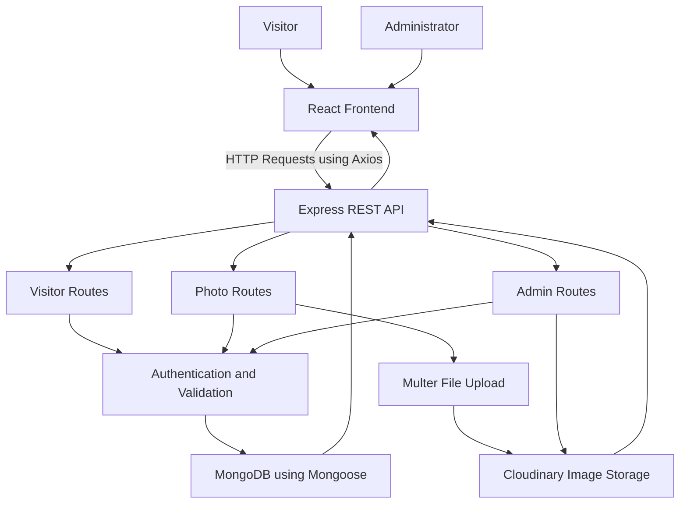
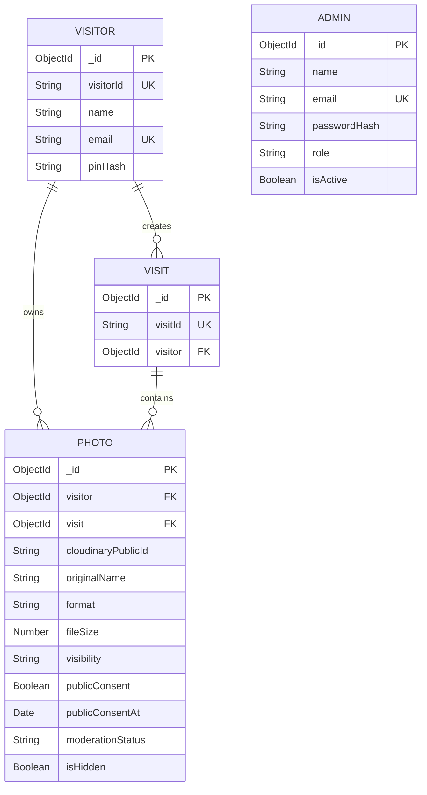

# System Architecture

## 1. Project Overview

Visitor Photo Slideshow is a full-stack web application that allows visitors to register, upload and manage photographs. Administrators can review public photo submissions and control which photographs are displayed in the Community Photo Gallery and Shared Slideshow.

The application follows a client-server architecture. The React frontend communicates with a Node.js and Express backend through REST API endpoints. MongoDB stores application records, while Cloudinary stores uploaded image files.

## 2. Technology Stack and Reasons

| Technology | Purpose | Reason for Selection |
|---|---|---|
| React 19 | Frontend development | Component-based interface development |
| Vite | Frontend development server and build tool | Fast development and production builds |
| Axios | HTTP communication | Makes API requests from React |
| Node.js | Backend runtime | Runs JavaScript on the server |
| Express 5 | Backend framework | Provides REST API routing and middleware |
| MongoDB | Database | Stores visitor, visit, photo and admin records |
| Mongoose | Database modelling | Defines schemas and interacts with MongoDB |
| JWT | Authentication | Provides token-based authentication |
| bcryptjs | Password and PIN hashing | Protects stored authentication credentials |
| Multer | File upload handling | Processes uploaded image files |
| Cloudinary | Image storage | Stores uploaded photographs |
| dotenv | Environment configuration | Loads configuration and secrets from environment variables |
| CORS | Cross-origin communication | Allows frontend-backend communication |

## 3. High-Level Architecture Diagram

## 4. Application Components

### 4.1 Frontend

The frontend is developed using React and Vite.

Its main responsibilities include:

- Visitor registration and login.
- Visitor dashboard.
- Photo uploading and personal photo management.
- Community Photo Gallery.
- Shared Slideshow.
- Administrator login and dashboard.
- Displaying photo moderation and approval information.

Axios is used to communicate with the backend API.

### 4.2 Backend

The backend uses Node.js and Express.

The main server file is `backend/server.js`.

It provides three major route groups:

| Route Group | Responsibility |
|---|---|
| `/api/visitors` | Visitor registration and login |
| `/api/photos` | Photo upload, retrieval, visibility, sharing and deletion |
| `/api/admin` | Administrator setup, login, dashboard statistics and photo moderation |

Authentication middleware protects routes that require visitor or administrator access.

### 4.3 Database

MongoDB is used with Mongoose for schema definition and database operations.

The application contains four main models.

#### Visitor Model

Stores visitor information:

- `visitorId`
- `name`
- `email`
- `pinHash`

#### Visit Model

Stores visit information:

- `visitId`
- `visitor`

Each visit references a visitor.

#### Photo Model

Stores photograph information:

- `visitor`
- `visit`
- `cloudinaryPublicId`
- `cloudinaryAssetId`
- `originalName`
- `format`
- `fileSize`
- `visibility`
- `publicConsent`
- `publicConsentAt`
- `moderationStatus`
- `isHidden`

Each photo references a visitor and a visit.

#### Admin Model

Stores administrator information:

- `name`
- `email`
- `passwordHash`
- `role`
- `isActive`

The application uses timestamps for its database models.

## 5. Database Relationship Diagram

The Admin model is separate and does not have a direct database relationship with the other three models.

## 6. Photo Upload and Moderation Workflow

The photo-sharing process follows these steps:

1. A visitor registers and logs in.
2. The visitor uploads photographs.
3. The backend validates the uploaded image files.
4. Multer processes the uploaded files.
5. Valid images are uploaded to Cloudinary.
6. Photo metadata is saved in MongoDB.
7. Photographs initially remain private.
8. A visitor can choose to make a photograph public by providing consent.
9. The photograph enters the pending moderation state.
10. An administrator reviews the photograph.
11. The administrator can approve, reject or revoke approval.
12. Approved, public and non-hidden photographs are displayed in the shared slideshow.

## 7. Authentication and Security

The application uses token-based authentication.

- Visitor PINs are hashed using bcryptjs before storage.
- Administrator passwords are hashed using bcryptjs before storage.
- JWT tokens are generated after successful login.
- Visitor and administrator authentication use separate middleware.
- Visitor photo operations check photo ownership.
- Public sharing requires explicit visitor consent.
- Administrator setup requires a configured setup secret.
- Cloudinary authenticated images are delivered using signed URLs.

## 8. External Services and Configuration

The application uses Cloudinary for image storage and MongoDB for persistent data storage.

Environment variables are used to configure:

- MongoDB connection URI.
- Backend port.
- JWT secret.
- Cloudinary credentials.
- Administrator setup secret.

Actual credentials must remain in the private `.env` file and must not be committed to the repository.

## 9. Development Architecture

The frontend and backend are maintained in separate folders.

The frontend runs using Vite, while the backend runs using Express.

During local development, the frontend sends HTTP requests to the backend running on port 5000.

The backend connects to MongoDB before starting its HTTP server.

## 10. Conclusion

The application uses a modular full-stack architecture that separates the user interface, server-side business logic, database operations and image storage.

This separation makes the application easier to maintain, test and extend.